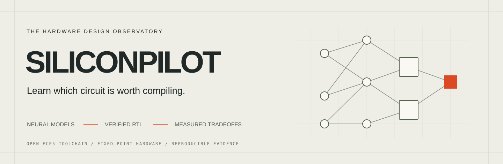
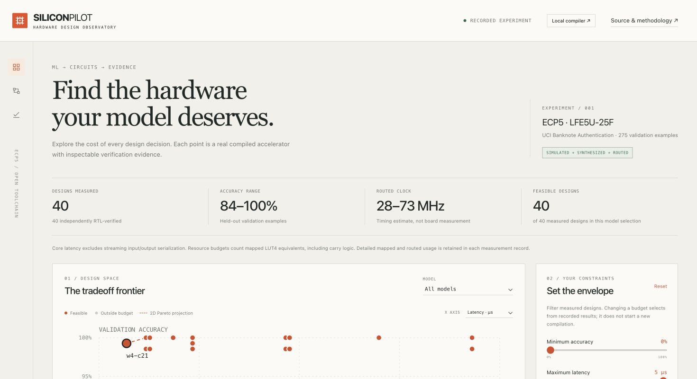
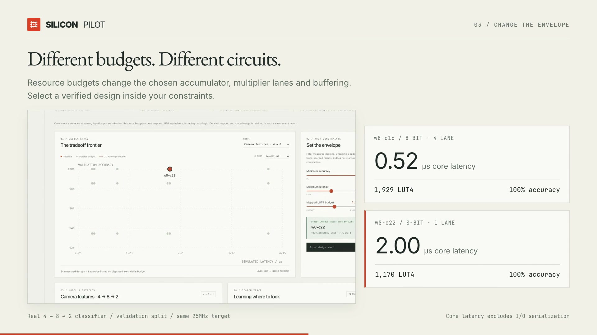
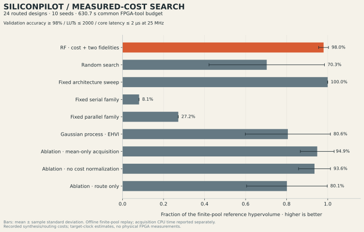
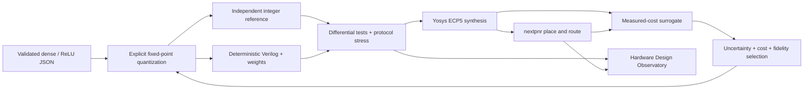

<p align="center"></p>

# SILICONPILOT

**A working ML-to-FPGA co-design laboratory, with the evidence attached.** Compile small dense/ReLU classifiers into fixed-point Verilog, independently test their arithmetic and handshakes, synthesize and route them for an ECP5, then learn which designs deserve the next expensive compilation.

[Hardware Design Observatory](https://nazeeh111.github.io/SILICONPILOT/) · [Arithmetic contract](docs/arithmetic.md) · [Research and prior art](docs/research.md) · [Search method](docs/search.md) · [Dataset](docs/dataset.md) · [Release](https://github.com/nazeeh111/SILICONPILOT/releases)

<p align="center"></p>

## What works

- **A small, explicit compiler.** Fixed-shape dense layers and ReLU, signed 3–16-bit arithmetic, configurable fractional/accumulator widths, multiplier lanes, product registers and buffering. Unsupported operations and malformed models fail clearly.
- **Real circuits.** Deterministic HDL, quantized weights, manifests, independent integer-reference testbenches, ECP5 synthesis and device-level place-and-route. All core tools are free and run locally on a CPU.
- **A measured search problem.** A random-forest cost surrogate, approximate uncertainty, two evaluation fidelities, live hardware search, and a standard Gaussian-process search baseline. Finite-corpus replays use the actual measured compilation costs.
- **An inspectable application.** Configure hardware budgets, select candidates on the Pareto plot, inspect the model/dataflow, read generated HDL and verification evidence, and replay genuine VCD waveforms. Local mode compiles and verifies through the same Python core as the CLI.

The camera-sensor demonstration uses four precomputed UCI Banknote Authentication wavelet features. Hardware accepts standardized features, not camera frames. Accuracy search uses validation rows. Test rows are kept separate. See the [dataset protocol](docs/dataset.md).

## 60-second demonstration

[](https://github.com/nazeeh111/SILICONPILOT/releases/download/v0.1.0/SILICONPILOT-demo.mp4)

The film uses real application captures and measured designs. Changing the LUT budget selects a 1,929-LUT4, 0.52-µs core or a 1,170-LUT4, 2.00-µs core. Both have 100% validation accuracy on this split. The source composition and verification are in [docs/demo](docs/demo/README.md); the video is intentionally silent.

## Evidence and scope

The canonical measured corpus is [benchmarks/corpus.json](benchmarks/corpus.json), with per-candidate HDL, logs and reports under [benchmarks/runs](benchmarks/runs). The [benchmark report](docs/benchmarks.md) gives current measurements, baseline results, held-out topology errors and ablations, including negative results.

The first corpus contains **40 RTL-verified, synthesized and routed designs** across hidden widths 4, 8 and 12. A separate LUT-only ECP5 implementation also passed exact mapped-netlist simulation on 353 vectors. The default DSP implementations have an explicitly documented simulation-model limitation. See [post-synthesis verification](docs/netlist.md).

The 24-design main-topology replay gives every method a 630.7-second FPGA-tool budget over 10 seeds, after the same cheap accuracy/latency feasibility screen. Mean recovered reference tradeoff volume is **98.0% for the learned policy, 70.3% for random, 80.6% for GP optimization and 100% for the fixed sweep**. The fixed sweep also consumes less compilation time on average. The ablations and superseded unpruned protocol are retained; this small study does not establish broad superiority. The held-out cost model predicts LUTs better than a constant baseline but does not improve route-cost prediction, and its uncertainty intervals under-cover.



**Simulation is not a board measurement.** Cycle latency is measured in RTL simulation for the packed core. The serial shell adds input/output serialization and backpressure. Fmax is a nextpnr timing estimate for LFE5U-25F-6/CABGA256 with a 25 MHz clock constraint. Pins are automatically assigned, external IO delays are unspecified, and no physical FPGA was tested. The release is a device-level research flow, not a board-ready programming image.

LUT budgets count mapped LUT4 equivalents, including two LUTs per CCU2C carry cell. Logic-only LUT4, carry LUT4, flip-flops, DSPs, block memories and routed TRELLIS_COMB utilization are retained separately. These resource definitions matter when comparing designs.

Learning FPGA costs and surrogate-assisted design search are established research. SILICONPILOT combines an open ECP5 implementation, measured experiments, inspectable artifacts and a tested cost/fidelity selection policy. [Research context](docs/research.md) describes established methods and limits.

## Reproduce

### Generate your first Verilog without installing

On macOS or Linux, the compiler can run directly from source with Python
3.12–3.14 and no third-party packages or FPGA toolchain:

```bash
git clone https://github.com/nazeeh111/SILICONPILOT.git
cd SILICONPILOT
PYTHONPATH=src python3 -m siliconpilot.cli compile models/banknote_4x8x2.json \
  --out work/first-design
```

Open `work/first-design/design.v` to inspect the generated dense stages and
streaming interface. `weights.json` contains the quantized model;
`manifest.json` records the configuration, arithmetic rules and file identity.
Choose a new output directory: compiling again into the same directory replaces
these three generated files. This command generates RTL; it does not simulate,
synthesize or route it. Continue below for those checks.

### Verify, synthesize and search

From the same source checkout, Python 3.12 and [OSS CAD Suite](https://github.com/YosysHQ/oss-cad-suite-build/releases/tag/2026-10-25) are required for the complete workflow. The compiler alone emits HDL without an FPGA toolchain. Training/search additionally use NumPy/SciPy/scikit-learn. No GPU, API key, proprietary HLS tool or paid service is required.

```bash
python3.12 -m venv .venv
source .venv/bin/activate
python -m pip install -r requirements-lock.txt
python -m pip install --no-deps -e .

# Download the appropriate OSS CAD Suite 2026-10-25 release, verify its
# checksum, unpack it, then add its bin directory to PATH.
export PATH="/absolute/path/to/oss-cad-suite/bin:$PATH"
siliconpilot doctor

# Generate HDL, verify all 275 validation rows plus stress vectors,
# synthesize and route a real device implementation.
siliconpilot build models/banknote_4x8x2.json \
  --out work/my-design --dataset

# A different verified hardware schedule from the same model.
siliconpilot build models/banknote_4x8x2.json \
  --out work/parallel-design --parallelism 4 --pipeline --dataset

# Fully modeled LUT-only ECP5 mapping, routing and post-synthesis simulation.
siliconpilot netlist work/my-design --logic-only-out work/logic-only
siliconpilot formal --out work/formal-tiny

# The real compiler is available in the local app.
siliconpilot serve --port 8791
# Open http://127.0.0.1:8791/
```

For the recorded observatory alone, serve `observatory/` with any static HTTP server. It needs no Python dependencies or live compilation service. The public demo clearly labels its results as recorded.

```bash
python -m http.server 8791 --directory observatory --bind 127.0.0.1

# Train from licensed source rows; reproduce model JSON and row splits.
siliconpilot train

# Run the learned policy against real tools, with a wall-time budget.
siliconpilot search models/banknote_4x8x2.json --out work/search \
  --evaluations 12 --budget-seconds 600 \
  --min-accuracy .98 --max-lut 2000 --max-latency-us 2

# Replay all baselines/ablations on the released measured corpus.
siliconpilot replay --corpus benchmarks/corpus.json --out work/replay \
  --seeds 10 --min-accuracy .98 --max-lut 2000 --max-latency-us 2

# Rebuild the predeclared 40-design corpus, then repeat the experiments.
PYTHONPATH=src python scripts/collect.py --workers 2 --output benchmarks/reproduced
PYTHONPATH=src python scripts/experiment.py benchmarks/reproduced/corpus.json \
  --output benchmarks/reproduced/search --seeds 10 --min-accuracy .98 \
  --max-lut 2000 --max-latency-us 2
python scripts/export_observatory.py
pytest -q
```

Compilation and routing cost depend on the CPU, concurrency, candidate and routing seed. A live tool invocation can overrun its time budget; it is reported and no further invocation starts. Search replays charge measured synthesis and routing time but report acquisition CPU time separately. They do not imply a live speedup. The first release uses one dataset, one FPGA and small networks, with two held-out hidden widths.

## Architecture



`src/siliconpilot/` contains the typed configuration, model validator, compiler, independent integer reference, verification harness, toolchain driver, learned search, CLI and loopback server. `models/` holds plain model JSON and train-only preprocessing. `benchmarks/` holds measured evidence. `observatory/` is a buildless HTML/CSS/JS viewer. `docs/demo/` retains the editable 60-second demo composition.

## Supported model format

```json
{
  "name": "tiny-classifier",
  "input_size": 2,
  "layers": [
    {"op":"dense","weights":[[0.5,-0.25],[0.25,0.75]],"bias":[0.0,0.1]},
    {"op":"relu"},
    {"op":"dense","weights":[[0.5,0.25],[-0.5,-0.25]],"bias":[0.0,0.0]}
  ]
}
```

Weight rows are output neurons; columns are inputs. Shapes, finite parameters and operation order are validated. The circuit emits fixed-point score vectors. Classification selects the maximum score, resolving ties toward the first class. Standardization and class selection run outside the circuit. Imported models can supply their own standardized validation JSON to `search --validation-data`; packaged-dataset accuracy is not transferable to unrelated models.

There is no automatic ONNX/PyTorch graph import, training in hardware, Conv1D backend, camera pipeline, bitstream flashing or physical-power claim. Conv1D is deferred until the dense subset has broader validation.

## Contributing and licensing

See [CONTRIBUTING.md](CONTRIBUTING.md) for development, meaningful checks and evidence requirements. Original source is [Apache-2.0](LICENSE). The dataset remains CC BY 4.0 with attribution; third-party tools and media keep their own licenses. See [THIRD_PARTY.md](docs/THIRD_PARTY.md). Do not describe generated test data, estimates or replayed results as physical hardware measurements.
