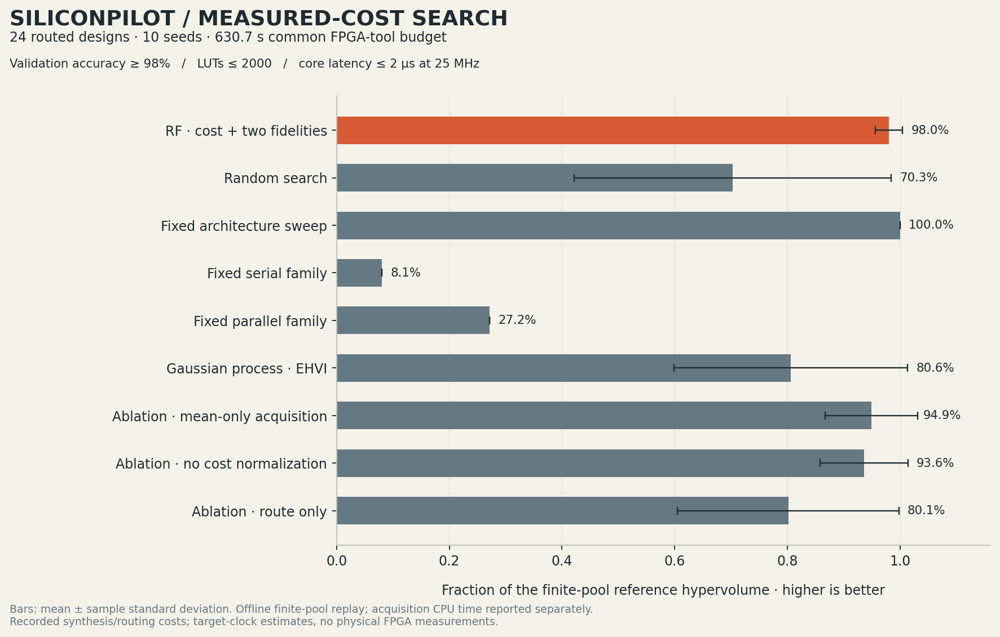
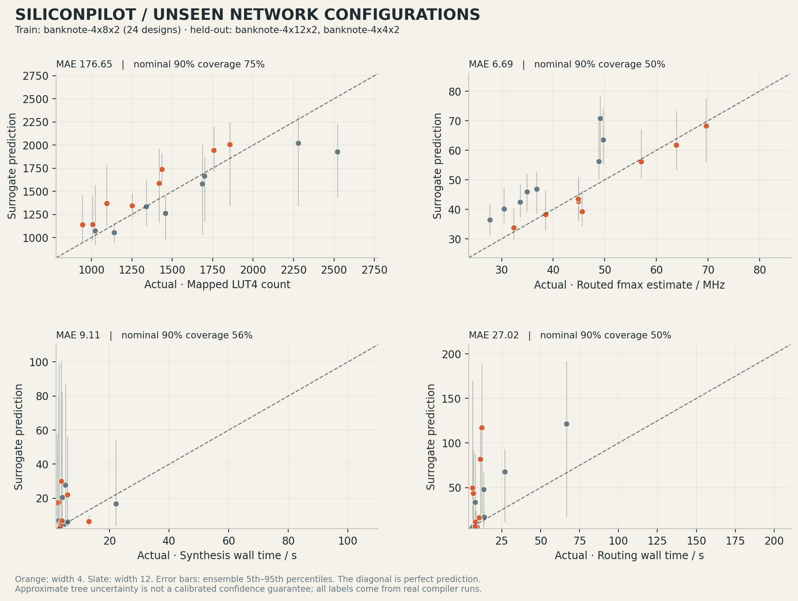

# Measured results and their limits

The release contains **40 independently RTL-verified, synthesized and routed ECP5
candidates**, a trained surrogate, and 90 matched-budget search replays. In the
corrected comparison the learned policy reaches 98.00% of the finite-pool
reference hypervolume on average; random search reaches 70.30%, GP expected
hypervolume improvement 80.59%, and the predetermined architecture sweep 100%.
The fixed sweep is better on both frontier recovery and consumed compilation
cost. These results support a working experimental search system, not general
superiority over conventional design choices.

## What was compiled and checked

The corpus contains 24 hardware configurations of a 4→8→2 dense/ReLU network,
plus eight paired configurations each of 4→4→2 and 4→12→2 networks. The last two
network widths are held out from surrogate training and search replay. All three
classifiers use the licensed UCI industrial-camera feature dataset described in
[dataset.md](dataset.md). Inputs are already standardized wavelet features;
preprocessing and image feature extraction are outside the circuit.

The coverage corpus varies 4/6/8-bit precision, fractional and accumulator
widths, 1/2/4 multiplier lanes, registered-product pipelining and one/two-vector
buffering. It is a predetermined finite coverage set, not exhaustive architecture
search. The device is LFE5U-25F, CABGA256, speed grade 6; nextpnr targets 25 MHz
with seed 1. Pin placement is automatic and external I/O delays are unspecified.
These are device-level research builds requiring board-specific constraints
before programming hardware.

Every candidate passes bit-exact RTL differential simulation on **353 vectors per
interface**: 78 boundary/random cases and 275 real validation rows, on both the
packed core and serialized shell. The checks include randomized output
backpressure, stable stalled output, reset during in-flight work and reset with
completed output stalled. Observed first-output cycle counts match the compiler's
cycle model. [audit.json](../benchmarks/audit.json) links the passing RTL digest
to the saved synthesis/routing artifacts and checks 12 artifact hashes for every
candidate.

RTL agreement does not by itself prove correctness of every mapped primitive.
The default corpus uses DSP blocks. Its exact ECP5 DSP netlist simulation is
explicitly unavailable because the pinned upstream model is a blackbox. A
separate, **actually synthesized and routed logic-only ECP5 implementation** of
the real classifier passes the exact mapped-netlist check on all 353 vectors:
1954 mapped LUT4 equivalents, 405 FF, 0 DSP, 0 BRAM, and a 43.7828 MHz routed
internal-frequency estimate. The original DSP build is preserved; its separately
synthesized generic-gate netlist also passes, with its different verification
scope labeled. See [netlist.md](netlist.md) for retained reports, hashes, primitive
boundaries and limitations. No result here implies a physical FPGA measurement,
delay-annotated routed simulation, or exhaustive formal equivalence.

| Metric across the 40 default candidates | Observed range |
| --- | ---: |
| Mapped LUT4 equivalents | 946–2522 |
| Flip-flops | 289–583 |
| DSP multipliers | 2–17 |
| Block RAMs | 0 |
| Routed internal fmax estimate | 27.7477–73.0620 MHz |
| Simulated core latency | 8–97 cycles |
| Core latency at the 25 MHz target | 0.32–3.88 µs |
| Analytic core throughput bound | 0.379–4.167 million vectors/s |
| Recorded synthesis plus routing cost | 8.187–217.443 s per candidate |

LUT equivalents count logic LUT4s plus two LUT4s per CCU2C carry cell. Raw cell
counts and routed combination utilization remain separately available. The
throughput value is an analytic initiation-interval bound, excluding shell
serialization, stalls and physical I/O. Latency is packed-core input acceptance
to output-valid for an empty pipeline without backpressure. The source reports
retain each metric's scope; these quantities must not be relabeled as board-level
throughput or measured silicon latency.

The sum of recorded compilation durations is 1716.509 seconds. Builds used two
concurrent workers on macOS arm64, Python 3.12 and OSS CAD Suite 2026-10-25,
including Yosys `0.70+219 / 5053d0e26` and nextpnr
`0.11.1-79-g22c5adf4`. Host load was not controlled. The substantial cost variation
is retained without trimming or normalization; these durations are observations
of this run, not portable compilation constants. Exact commands and version
strings remain in each build report and [protocol.json](../benchmarks/protocol.json).

## Search comparison

The common maximum FPGA-tool budget is **630.707129 seconds**, 45% of the measured
compilation cost of the 24-design training-topology pool. Constraints were fixed
before the final corpus finished: validation accuracy at least 98%, at most 2000
mapped LUT4 equivalents, and at most 2 µs core latency at 25 MHz. All policies
apply the same cheap known-accuracy **and analytic-latency** feasibility filter
before querying synthesis or routing. LUT counts and routed timing are revealed
only after their paid query. The full finite-pool feasible hypervolume is
0.096620, normalized to 100% below.

| Policy | Reference hypervolume recovered, mean ± sample SD | Mean consumed compilation time | Mean routed designs |
| --- | ---: | ---: | ---: |
| RF cost-aware, two fidelities | **98.00 ± 2.40%** | 592.64 s | 5.2 |
| Random search | 70.30 ± 28.13% | 576.81 s | 7.6 |
| Predetermined architecture sweep | **100.00 ± 0.00%** | 533.85 s | 5.0 |
| Fixed serial family | 8.08 ± 0.00% | 26.78 s | 2.0 |
| Fixed parallel family | 27.19 ± 0.00% | 246.01 s | 2.0 |
| Gaussian process expected hypervolume improvement | 80.59 ± 20.73% | 560.87 s | 5.2 |
| Ablation: mean-only acquisition | 94.91 ± 8.23% | 599.47 s | 7.8 |
| Ablation: no cost normalization | 93.57 ± 7.77% | 561.14 s | 5.2 |
| Ablation: no low fidelity | 80.12 ± 19.66% | 570.09 s | 5.5 |

All stochastic policies use seeds 0–9. Repeating a deterministic fixed ordering
does not add independent evidence. The table reports a common **maximum** budget;
it does not force a fixed family to waste time after exhausting its subgroup.
The learned policy's mean is higher than the stochastic baselines in this
particular pool. The deterministic sweep still wins. Ablations show directional
reductions here, but ten seeds and one small pool do not establish a universal
benefit for uncertainty or cost normalization.



The learned policy spends an average 2.685 seconds on acquisition CPU work,
compared with 1.507 seconds for GP EHVI. Acquisition CPU time is measured
separately and excluded from the common FPGA-tool budget. This is **offline
finite-pool measured-cost replay**, not a claim of an observed end-to-end online
speedup. A query that would complete after the cutoff is censored without
revealing its labels or selecting a cheaper alternative. All reported frontier
improvements come from queries completed within the same cutoff. The replay
contains only successfully compiled designs and therefore does not evaluate
failure prediction or failed-build cost. Live search separately records actual
failed tool attempts and enforces stage boundaries after verification/synthesis.

Independent review corrected the first replay's omission of the cheap analytic
latency filter. The unchanged constraints, seeds, corpus and budget were then
used to rerun all 90 comparisons. Current results carry protocol revision
`known_accuracy_and_analytic_latency_screen_v2`. The superseded first result,
source and plots remain under [search-unpruned](../benchmarks/search-unpruned/README.md)
for provenance and do not supply current performance claims. The implementation
and policy equations are documented in [search.md](search.md).

With the same 2000-LUT/2-µs constraints, relaxing only the minimum validation
accuracy leaves 17/24 feasible candidates at 90%, 10/24 at 98%, and 7/24 at 100%.
This is feasibility sensitivity, not a retuned search comparison.

## Surrogate transfer to unseen network widths

The saved 96-tree surrogate fits only the 24 width-8 designs. It predicts the
16 width-4/12 designs without training on any of their resource, timing or cost
labels. The baseline predicts the training-label mean for every held-out design.

| Predicted quantity | Held-out MAE | Mean-predictor MAE | Empirical coverage of nominal 90% ensemble interval |
| --- | ---: | ---: | ---: |
| Mapped LUT4 equivalents | 176.65 | 378.16 | 75.00% |
| Routed fmax estimate | 6.69 MHz | 9.98 MHz | 50.00% |
| Synthesis duration | 9.11 s | 15.72 s | 56.25% |
| Routing duration | 27.02 s | **26.80 s** | 50.00% |

The predictor improves resource, timing and synthesis-duration mean absolute
error over the mean baseline in this held-out set. It **does not improve routing
cost MAE**, and all nominal 90% intervals under-cover. Routing-cost mean absolute
percentage error is approximately 235%. These are important weaknesses, not a
calibrated uncertainty guarantee or a reliable broad cost-generalization claim.
A larger diverse corpus, controlled timing measurements and explicit uncertainty
calibration are needed before stronger conclusions. Current topology/configuration
features also omit detailed quantized-weight statistics that can affect constant
folding and mapping.



The fitted artifact is [surrogate.joblib](../benchmarks/search/surrogate.joblib).
Its [metadata](../benchmarks/search/surrogate_metadata.json) includes features,
targets, versions, train/held-out IDs, per-design predictions, empirical interval
coverage, and a canonical normalized-record hash. That hash uses normalized,
sorted JSON and is distinct from the source file byte hash in the audit.

## Constraint-change demonstration and final test rows

Architecture choices use validation scores and hardware reports. Only after
those choices are fixed are the separate 275 test rows evaluated. The three
constraint scenarios select different independently RTL-verified circuits:

| Scenario | Chosen candidate | Mapped LUT4s | Core latency at 25 MHz | Routed fmax estimate | Final test accuracy |
| --- | --- | ---: | ---: | ---: | ---: |
| Compact logic: ≤1200 LUT, ≤3 µs | `w8-c22` | 1170 | 2.00 µs | 42.22 MHz | 275/275 |
| Balanced: ≤1800 LUT, ≤2 µs | `w8-c14` | 1720 | 1.00 µs | 37.49 MHz | 275/275 |
| Tight latency: ≤2000 LUT, ≤1 µs | `w8-c16` | 1929 | 0.52 µs | 33.62 MHz | 275/275 |

All require at least 98% validation accuracy. The saved
[final-test.json](../benchmarks/final-test.json) records the selection rule, exact
configuration, test score and a further 353-vector-per-interface differential
check using those test rows. The row split does not establish unseen-camera or
unseen-specimen generalization because the source dataset supplies no such group
identifiers. The circuits consume processed features, not raw banknote images.

## Reproduction and provenance

From the repository root, with the pinned environment and free toolchain on PATH:

```sh
python -m siliconpilot.dataset train --root .
python scripts/collect.py --root . --output benchmarks/reproduced --workers 2
python scripts/experiment.py benchmarks/reproduced/corpus.json --output benchmarks/reproduced/search \
  --seeds 10 --min-accuracy .98 --max-lut 2000 --max-latency-us 2 --clock-mhz 25
```

The collector requires a fresh output directory by default, preserving the
release evidence. Explicit `--resume` checks the model, configuration and every
retained artifact hash before reusing a build. To rerun only the search comparison
on the retained measurement corpus, pass `benchmarks/corpus.json` to the experiment
script and choose a new result directory.

The retained corpus source byte SHA-256 is
`29b8df9f8a45749c0e33e47b32e27aa9a0a1adcc035d62620cfe90ae0eceab9e`.
Source bytes, outputs and commands are available under
[benchmarks](../benchmarks/). Every candidate retains HDL, quantized weights,
constraints, RTL testbenches, actual simulation logs/waveforms, synthesis logs,
netlists, routing reports and digests. A new run can produce different durations
and tool estimates; it must not silently inherit the recorded benchmark's
performance claims. Charts are generated directly from the saved reports, with
source hashes in `docs/assets/search-figures-manifest.json`; SVG versions remain
editable.

Large reproducible netlists, full waveform dumps, and routed configuration files
are preserved in the versioned release asset
`SILICONPILOT-v0.1.0-evidence.tar.gz`. The Git source keeps readable reports,
logs, testbenches and digests; the public observatory additionally includes the
candidate RTL waveforms it displays. Extract the evidence archive at the repository
root to restore all saved build intermediates without recompiling. It contains
`benchmarks/`, `models/` and licensed `data/`; use a fresh checkout when restoring
it so an independent experiment is preserved.
